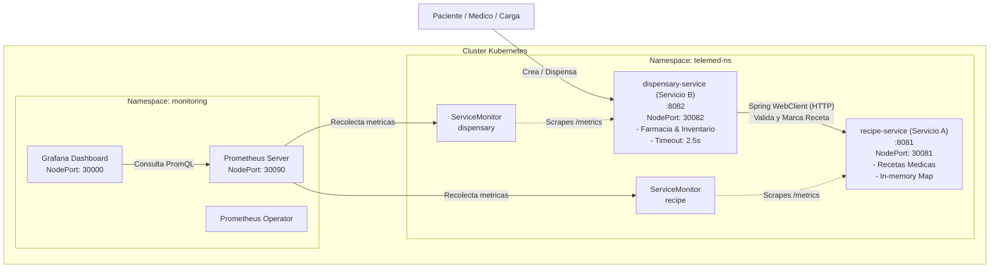

# Microservicios Java con Monitoreo en Kubernetes — Valle Grande

**Curso:** Kubernetes con Prometheus & Grafana — Valle Grande  
**Dominio de Negocio:** Telemedicina & Farmacia Digital  
**Modalidad:** Individual (Puntaje Total: 20/20)

---

## 🏥 Arquitectura del Dominio de Negocio

Este sistema modela un ecosistema de salud digital donde la emisión de recetas médicas y la dispensación farmacéutica operan como microservicios desacoplados pero interconectados:



- **Servicio A (`recipe-service`):** Emite y valida recetas médicas digitales. Expone endpoints de gestión y soporta inyección de latencia artificial (`DELAY_MS`) para pruebas de resiliencia.
- **Servicio B (`dispensary-service`):** Procesa pedidos de dispensación de medicamentos. Consulta obligatoriamente al Servicio A mediante **Spring WebClient** con un timeout estricto de **2500 ms** y mecanismo de contingencia (*fallback*).

---

## 📁 Estructura del Repositorio

```text
.
├── microservices/
│   ├── recipe-service/          # Servicio A: Spring Boot 3 + Micrometer
│   │   ├── Dockerfile           # Multi-stage build con Temurin 17
│   │   ├── pom.xml
│   │   └── src/
│   └── dispensary-service/      # Servicio B: Spring Boot 3 + WebClient
│       ├── Dockerfile           # Multi-stage build con Temurin 17
│       ├── pom.xml
│       └── src/
├── k8s/
│   ├── monitoring-values.yaml   # Configuración Helm (NodePort, selectores)
│   ├── namespace.yaml           # Namespace telemed-ns
│   ├── recipe-service.yaml      # Deployment (probes, limits) + Service
│   ├── dispensary-service.yaml  # Deployment (probes, limits) + Service
│   ├── servicemonitors.yaml     # ServiceMonitors para Prometheus
│   ├── prometheus-rules.yaml    # 5 Alertas PromQL (técnicas y negocio)
│   └── grafana-dashboard.json   # Dashboard con 7 paneles exportado
├── load-testing/
│   ├── stress.sh                # Generador de carga en Bash
│   └── stress.ps1               # Generador de carga en PowerShell
├── scripts/
│   ├── setup.sh                 # Despliegue 100% desatendido (Linux/macOS/Git Bash)
│   ├── setup.ps1                # Despliegue 100% desatendido para Windows PowerShell
│   ├── teardown.sh              # Limpieza de recursos y cluster
│   └── teardown.ps1             # Limpieza en PowerShell
└── docs/
    ├── informe.md               # Informe técnico completo (Partes A, B, C y D)
    └── casuisticas.md           # Guía de reproducción de las 3 casuísticas
```

---

## ⚙️ Prerrequisitos e Instalación de Herramientas

### Comandos de instalación según Sistema Operativo

#### Windows (vía Chocolatey o Winget):
```powershell
# Usando winget:
winget install Docker.DockerDesktop
winget install Kubernetes.minikube
winget install Kubernetes.kubectl
winget install Helm.Helm

# O usando Chocolatey:
choco install docker-desktop minikube kubernetes-cli kubernetes-helm -y
```

#### Linux (Ubuntu/Debian):
```bash
# Docker
sudo apt-get update && sudo apt-get install -y docker.io
sudo usermod -aG docker $USER && newgrp docker

# Minikube
curl -LO https://storage.googleapis.com/minikube/releases/latest/minikube-linux-amd64
sudo install minikube-linux-amd64 /usr/local/bin/minikube

# kubectl
curl -LO "https://dl.k8s.io/release/$(curl -L -s https://dl.k8s.io/release/stable.txt)/bin/linux/amd64/kubectl"
sudo install kubectl /usr/local/bin/kubectl

# Helm
curl https://raw.githubusercontent.com/helm/helm/main/scripts/get-helm-3 | bash
```

#### macOS (vía Homebrew):
```bash
brew install --cask docker
brew install minikube kubectl helm
```

---

## 🚀 Despliegue Desatendido (Sección 6)

Para levantar el cluster, compilar las imágenes, instalar el stack de monitoreo y desplegar los microservicios de manera 100% automática:

### En Linux / macOS / Git Bash:
```bash
chmod +x scripts/*.sh load-testing/*.sh
./scripts/setup.sh
```

### En Windows PowerShell:
```powershell
Set-ExecutionPolicy -ExecutionPolicy RemoteSigned -Scope Process
.\scripts\setup.ps1
```

---

## 🌐 URLs del Sistema y Credenciales

Una vez finalizado el despliegue, consulta la IP del nodo con `minikube ip` (ej. `192.168.49.2`):

| Servicio | URL de Acceso | Credenciales |
| :--- | :--- | :--- |
| **Grafana** | `http://<MINIKUBE_IP>:30000` | Usuario: `admin`<br/>Contraseña: `AdminValleGrande2026!` |
| **Prometheus** | `http://<MINIKUBE_IP>:30090` | Acceso libre |
| **Prometheus Targets** | `http://<MINIKUBE_IP>:30090/targets` | Ambos servicios deben estar **UP (1/1)** |
| **Recipe Service** | `http://<MINIKUBE_IP>:30081` | Health: `/health` \| Métricas: `/metrics` |
| **Dispensary Service** | `http://<MINIKUBE_IP>:30082` | Health: `/health` \| Métricas: `/metrics` |

---

## 📊 Importar Dashboard en Grafana

1. Ingresa a `http://<MINIKUBE_IP>:30000`.
2. En el menú lateral, dirígete a **Dashboards** → **New** → **Import**.
3. Carga el archivo [`k8s/grafana-dashboard.json`](file:///d:/kubernetes/k8s/grafana-dashboard.json) o pega su contenido.
4. Selecciona el datasource **Prometheus** y haz clic en **Import**.
5. Verás los 7 paneles operativos en tiempo real.

---

## 🧪 Pruebas de Carga

Para generar tráfico y observar la variación de métricas y latencias en Grafana:

```bash
# Generar 50 peticiones concurrentes
./load-testing/stress.sh $(minikube ip) 50 0.3

# En PowerShell:
.\load-testing\stress.ps1 -TotalRequests 50 -SleepSeconds 0.3
```

---

## 🚨 Demostración de las 3 Casuísticas

Consulta [`docs/casuisticas.md`](file:///d:/kubernetes/docs/casuisticas.md) para el detalle completo de cada una:

1. **🔴 Casuística 1 — Servicio Caído (`CrashLoopBackOff`):**
   ```bash
   kubectl set env deployment/recipe-deployment SIMULATE_FAILURE=true -n telemed-ns
   # Recuperación:
   kubectl set env deployment/recipe-deployment SIMULATE_FAILURE=false -n telemed-ns
   ```
2. **🟡 Casuística 2 — Servicio Lento (Latencia y Timeouts en cascada):**
   ```bash
   curl -X POST "http://$(minikube ip):30081/api/recipes/config/delay?ms=4000"
   ./load-testing/stress.sh $(minikube ip) 10 0.2
   # Recuperación:
   curl -X POST "http://$(minikube ip):30081/api/recipes/config/delay?ms=0"
   ```
3. **🟠 Casuística 3 — Agotamiento de Stock Farmacéutico:**
   ```bash
   # Solicitar dispensación superior al inventario de MED-IBU-400
   curl -X POST "http://$(minikube ip):30082/api/dispensations" -H "Content-Type: application/json" -d '{"recipeId":"REC-1003","patientDni":"10492837"}'
   # Recuperación:
   curl -X POST "http://$(minikube ip):30082/api/dispensations/pharmacy/restock?medicationCode=MED-IBU-400&amount=50"
   ```

---

## 🧹 Limpieza del Entorno (`teardown`)

```bash
# Eliminar despliegues y release de monitoreo:
./scripts/teardown.sh

# Eliminar también el cluster Minikube completo:
./scripts/teardown.sh --all
```
